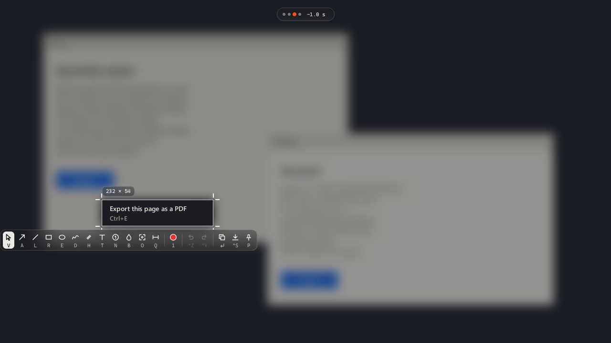
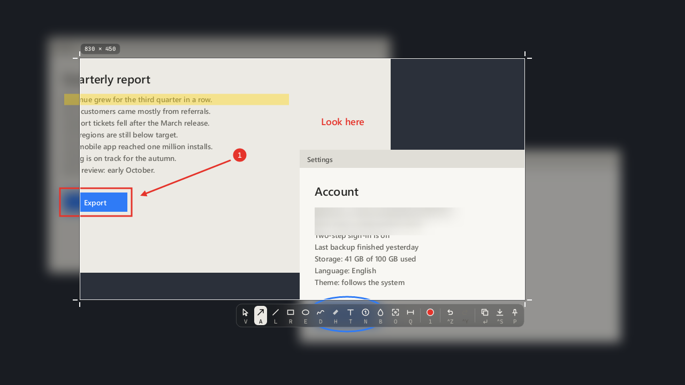
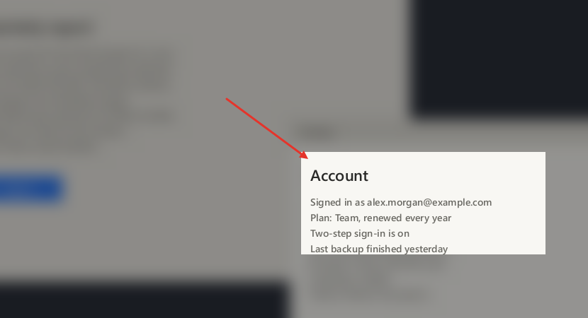

<p align="center"></p>

<h1 align="center">Bruma</h1>

<p align="center">A screenshot tool for Windows that remembers the last few seconds.</p>

<p align="center">
  <a href="https://github.com/0301091405/bruma/releases/latest"></a>
  
</p>


Press the hotkey and the screen freezes. Drag a region or click a window, draw
on it if you need to, press Enter. The picture is on your clipboard.

If what you wanted was a tooltip or a menu that closed before you reached the
hotkey, turn the mouse wheel. Bruma keeps the last four seconds of the screen
in memory and lets you step back through them.

It's a single executable of about 2 MB, written in Rust. It makes no network
connections. Windows 10 and 11 only for now.

## Install

Download [bruma-setup.exe](https://github.com/0301091405/bruma/releases/latest/download/bruma-setup.exe)
and run it. Setup takes a few seconds, doesn't ask for administrator rights
and starts Bruma when it's done. From then on Bruma sits in the tray and waits
for `PrintScreen`.

It needs 64-bit Windows 10 (version 1809 or later) or Windows 11, and nothing
else.

The files aren't signed, so your browser and SmartScreen may warn about them.
In the SmartScreen window choose "More info", then "Run anyway".

Or paste this into PowerShell. It downloads the same setup program, checks it
and runs it without any questions:

```
irm https://raw.githubusercontent.com/0301091405/bruma/main/install.ps1 | iex
```

If you'd rather not install anything, [bruma.exe](https://github.com/0301091405/bruma/releases/latest/download/bruma.exe)
is the whole program in one file. Put it anywhere and run it.

To remove Bruma, use "Installed apps" in Windows Settings. Your settings and
capture history are left where they are.

Or build it yourself (Rust 1.85 or newer):

```
cargo install --git https://github.com/0301091405/bruma bruma
```

## What it does

### Rewind

Open the overlay and scroll the wheel (or press `PgUp`) to go back through the
last few seconds. From there:

- `W` selects whatever changed: the popup that just appeared, or the one that
  just went away.
- `K` saves those seconds as a GIF.
- `J` puts two moments side by side with the difference outlined, which is
  usually what a bug report needs.



### Snap

Point at a button, a box or a picture and it gets an outline; click to select
it. If you drag instead, the edges settle on the nearest real edge. This works
from the pixels, so it doesn't matter what kind of program is underneath.
`G` turns it off, holding `Alt` suspends it.


### Drawing

Arrow, line, rectangle, ellipse, pen, highlighter, text, numbered steps, blur
and a ruler, all in the same overlay. There is no separate editor window.
Every tool is one key and `F1` lists them.



### Focus

The opposite of blurring something out: mark the part that matters with `O`
and the rest of the capture goes soft.



### Private text

`M` reads the selection and blurs what looks private: e-mail addresses, phone
and card numbers, IBANs, IP addresses, API keys, whatever follows `Password:`.
`X` copies the text instead. Both use the text recognition that ships with
Windows, so nothing leaves the machine.

These are heuristics and the recognition does miss things. Check the result
before you send it.

### Smaller things

- Scrolling capture (`Y`) scrolls the page for you and joins the pieces.
- A saved PNG keeps its drawings inside the file. `bruma edit shot.png` opens
  it again with every arrow still movable.
- History keeps the last 200 captures and can be searched by the text in them.
- `U` puts the capture in a frame with rounded corners and a shadow.
- `C` copies the colour under the cursor. `P` pins the capture on screen.
- `run_after` runs a command on every saved file, for uploading or anything
  else. If the command prints a URL, the URL is copied.

## Keys

| Key | |
|---|---|
| drag | select a region |
| click | select the box, picture or window under the cursor |
| `F`, `Z` | whole monitor, the region used last time |
| `S` | shrink the selection to its content |
| wheel, `PgUp` `PgDn` | rewind |
| `W` `J` `K` | select what changed, before/after picture, GIF |
| `V` `A` `L` `R` `E` | select, arrow, line, rectangle, ellipse |
| `D` `H` `T` `N` | pen, highlighter, text, numbered step |
| `B` `O` `Q` | blur, focus, ruler |
| `1` to `6`, `[` `]` | colour, stroke width |
| `M` `X` | blur private text, copy text |
| `Ctrl+Z` `Ctrl+Y` `Del` | undo, redo, delete |
| `Enter` or `Ctrl+C` | copy and close |
| `Ctrl+S` | save and close |
| `Esc` | one step back, then close |

`F1` in the overlay shows the full list.

## Command line

```
bruma                               run in the background (tray and hotkey)
bruma capture                       open the overlay now
bruma capture --delay 3             open it in 3 seconds
bruma capture --full -o shot.png    save the whole screen without the overlay
bruma capture --region 0,0,800,600 -o shot.png
bruma edit shot.png                 reopen a saved capture
bruma find invoice                  list past captures containing a word
bruma mask shot.png                 blur private text in an existing PNG
bruma ocr shot.png                  print the text in a PNG
bruma lab                           open a page for trying every feature
bruma probe                         time screen reads on this machine
```

If another program already owns `PrintScreen`, Bruma falls back to
`Ctrl+PrintScreen`, then `Ctrl+Alt+B`, and says which one in the tray menu.

## Settings

Everything is optional. "Settings" in the tray menu opens
`%APPDATA%\bruma\config.toml` and creates it with the defaults if it's missing.

```toml
hotkey    = "PrintScreen"               # or "ctrl+shift+KeyS"
save_dir  = "~/Pictures/bruma"
filename  = "bruma-%Y%m%d-%H%M%S.png"
color     = 1                           # default colour, 1-6
stroke    = 3                           # default stroke width
snap      = true
autosave  = false                       # also save a file on every copy
preview   = 4                           # seconds the preview card stays
rewind    = 4                           # seconds of screen history, 0 = off
rewind_fullscreen = false               # record while a game or film is full screen
fast_capture = true                     # false = always read the screen with GDI
cursor    = false                       # include the mouse cursor
history   = 200                         # captures kept, 0 = off
run_after = ""                          # 'curl -s -F "file=@{file}" https://example.com/upload'
```

## Speed and cost

On a 1080p monitor the frozen screen is up 25 to 30 ms after the hotkey. A
frame while you drag or draw takes 2 to 4 ms.

Rewind is the only part that works while you aren't using it. It samples the
screen twice a second at low priority and takes a bit under 1% of one core
while the screen keeps changing, close to nothing when it doesn't. It stops
while a game or a film is full screen. Memory is 8 MB when the screen is still
and up to about 100 MB when it changes all the time. `rewind = 0` turns it off.

## What it doesn't do

- No video recording. `K` gives you the last few seconds at two frames a
  second and that's all.
- No built-in upload services. Use `run_after`.
- No Linux or macOS yet. The core doesn't depend on Windows, the app does.
- It has mostly been tested on one 1080p monitor. Multiple monitors and
  display scaling should work but have seen little testing; reports are welcome.

## Building

```
cargo build --release
cargo test
```

Needs Rust 1.85 or newer. The code is two crates: `bruma-core` is the logic
and the drawing, with no window and no OS calls, and `bruma` is the Windows
application around it.

## Privacy

No network code, no telemetry, no update check. Captures go to your clipboard,
your disk and the local history folder (`%LOCALAPPDATA%\Bruma\history`), and
nowhere else unless you set `run_after` to send them somewhere.

## License

MIT or Apache-2.0, whichever you prefer. See [LICENSE-MIT](LICENSE-MIT) and
[LICENSE-APACHE](LICENSE-APACHE).
