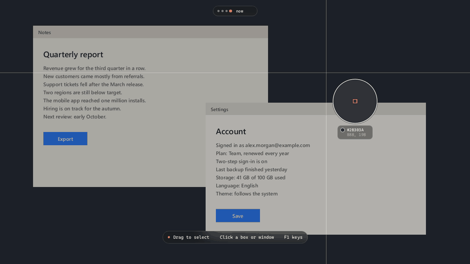
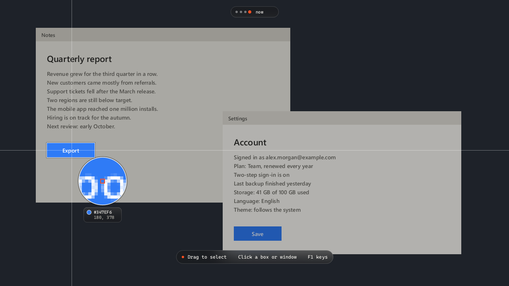
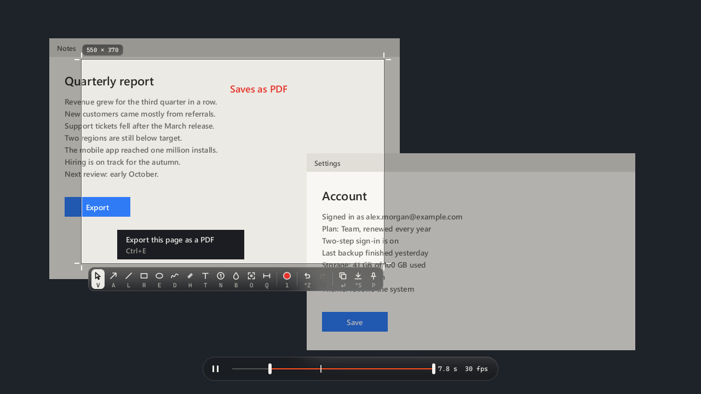
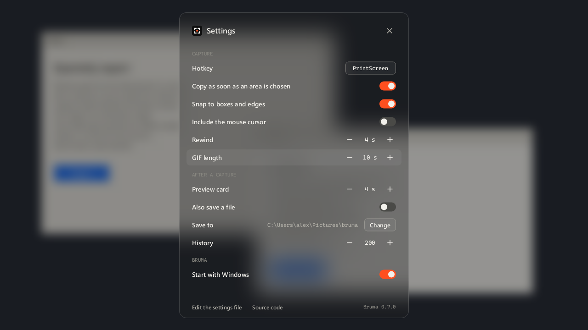

<p align="center"></p>

<h1 align="center">Bruma</h1>

<p align="center">A screenshot tool for Windows that remembers the last few seconds.</p>

<p align="center">
  <a href="https://github.com/0301091405/bruma/releases/latest"></a>
  
</p>



Press `PrintScreen`, pick an area and it's on your clipboard. If the tooltip
or menu you wanted closed too early, scroll back: Bruma keeps the last few
seconds of the screen.

One executable of about 2 MB. No network access. Windows 10 and 11.

## Install

Download [bruma-setup.exe](https://github.com/0301091405/bruma/releases/latest/download/bruma-setup.exe)
and run it. At the end Windows asks once whether Bruma may run as
administrator. Many games run that way (anti-cheat often starts them so), and
Windows keeps their keys from programs that don't, so this is what lets
`PrintScreen` work in them. Say no and Bruma runs as an ordinary program,
which works everywhere but in those games; "Work over games run as
administrator" in Settings asks again. Bruma then waits in the tray.

Or paste this into PowerShell:

```
irm https://raw.githubusercontent.com/0301091405/bruma/main/install.ps1 | iex
```

[bruma.exe](https://github.com/0301091405/bruma/releases/latest/download/bruma.exe)
is the same program without setup. Put it anywhere and run it.

On Windows 11, `PrintScreen` normally opens the Snipping Tool. Bruma takes
the key back without changing that setting.

The files aren't signed, so SmartScreen may warn you. Choose "More info", then
"Run anyway". To remove Bruma, use "Installed apps" in Windows Settings.

## How it works

- **Copy.** Drag over an area, or click a box, a picture or a window. It's
  copied at once. Click the card that appears to draw on it, or hold `Shift`
  as you let go.
- **Snap.** Whatever is under the cursor gets an outline. `Tab` steps out to
  the larger area around it, like the page of a browser, then the window.
- **Rewind.** Turn the mouse wheel to go back through the last few seconds.
  `W` selects what changed.
- **GIF.** `K` turns the last ten seconds into a GIF at 30 frames a second.
  Trim it, draw on it, and `Enter` copies it as a file.
- **Draw.** Arrows, boxes, text, numbered steps, blur and more, right on the
  screen. There is no separate editor.
- **Games.** `PrintScreen` works in full-screen games too. The game steps
  back while you choose, as it would for `Alt+Tab`, and you're returned to it
  afterwards. If Windows won't let anything show over the game, the whole
  screen is copied and a shutter sound says so.
- **Private text.** `M` blurs e-mail addresses, card numbers, passwords and
  the like. `X` copies the text. It uses the text recognition built into
  Windows and can miss things, so check before you send.






## Keys

| Key | |
|---|---|
| drag, click | copy an area, or the box or window under the cursor |
| `Tab`, `Shift+Tab` | a larger or smaller area |
| `F`, `Z` | whole monitor, the last area again |
| wheel, `PgUp` `PgDn` | rewind |
| `W` `K` `J` | what changed, GIF, before/after |
| `A` `L` `R` `E` | arrow, line, rectangle, ellipse |
| `D` `H` `T` `N` | pen, highlighter, text, numbered step |
| `B` `O` | blur, focus |
| `M` `X` | blur private text, copy text |
| `Ctrl+Z` `Ctrl+Y` | undo, redo |
| `Enter`, `Ctrl+S` | copy, save |
| `Esc` | back, then close |

`F1` in Bruma lists every key. `bruma --help` lists the command line.

## Settings

Right-click the tray icon and choose Settings. Changes apply at once and are
kept in `%APPDATA%\bruma\config.toml`.



## Privacy

No network code, no telemetry, no update check. Captures go to your clipboard,
your disk and a local history folder, nowhere else.

While Bruma runs it keeps a short recording of the screen in memory for rewind
and GIFs. It reads only what changes and uses a few percent of one core while
something on screen keeps moving. While a game or a film fills the screen it
stops and gives that memory back. On battery it records at half the rate, and
not at all with the battery saver on. Setting `rewind = 0`
and `clip = 0` in the settings file turns it off.

Running as administrator means anything Bruma starts runs that way too,
including a command set in `run_after`. Turn it off in Settings if you'd
rather not.

## When something doesn't work

Right-click the tray icon and choose "Copy a report for a bug", or run
`bruma doctor`. It describes your Windows, monitors and Bruma's settings, and
leaves out your name and folders. Paste it into an
[issue](https://github.com/0301091405/bruma/issues).

## Building

```
cargo build --release
```

Rust 1.85 or newer. `bruma-core` holds the logic and drawing, `bruma` is the
Windows app.

## License

MIT or Apache-2.0, whichever you prefer. See [LICENSE-MIT](LICENSE-MIT) and
[LICENSE-APACHE](LICENSE-APACHE).
